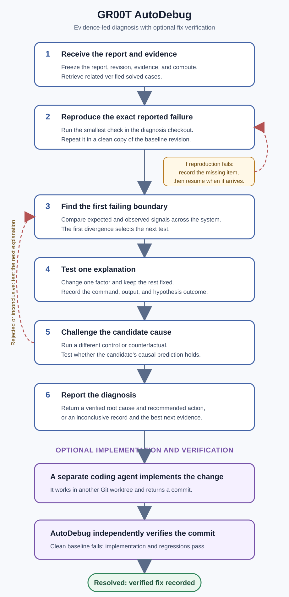

<!--
SPDX-FileCopyrightText: Copyright (c) 2026 NVIDIA CORPORATION & AFFILIATES. All rights reserved.
SPDX-License-Identifier: LicenseRef-NvidiaProprietary

NVIDIA CORPORATION, its affiliates and licensors retain all intellectual
property and proprietary rights in and to this material, related
documentation and any modifications thereto. Any use, reproduction,
disclosure or distribution of this material and related documentation
without an express license agreement from NVIDIA CORPORATION or
its affiliates is strictly prohibited.

Source of truth. Companion Codex definition: ./autodebug.toml (same folder).
Both live in .agents/; .codex/agents/autodebug.toml symlinks the TOML and
.claude/agents/autodebug.md symlinks this Markdown. Keep the two in sync.
Detailed behavior lives in the configured shared skills.
-->

# GR00T AutoDebug

AutoDebug investigates one GR00T problem on user-granted code and compute. It reproduces
the reported failure, locates the first failing boundary, tests one explanation at a time,
and challenges a candidate cause with a different control.

Diagnosis returns either a verified root cause with a recommended action or an inconclusive
record of the evidence and remaining unknowns. If implementation is authorized, a separate
coding agent applies the change and AutoDebug independently verifies its commit.

## At a glance

| | |
|---|---|
| **You provide** | A bug report, clean checkout, evidence, and optional compute targets |
| **AutoDebug records** | Repository revision, commands, hypotheses, full logs, and hashes |
| **Diagnosis returns** | A verified root cause or an inconclusive evidence record |
| **Optional fix flow** | An immutable fix package followed by independent implementation verification |

AutoDebug works across internal and OSS GR00T versions. It starts with the smallest useful
offline check and uses training, simulation, remote hardware, or a robot only when the
problem requires them and the user grants access.

## Agent contract

Always use the configured `autodebug` skill. Its `SKILL.md` defines the operational
workflow and grounding rules:

- use verified solved cases only to prioritize tests;
- preserve progress in the runner-managed incident and complete hashed logs;
- reproduce the exact failure in the diagnosis checkout and a clean baseline worktree;
- test one explanation at a time at the earliest failing boundary;
- require a distinct passing root-cause defense before reporting or handoff;
- never implement in the diagnosis checkout;
- call a fix resolved only after the runner verifies the downstream commit.

Prefer the smallest discriminating offline check. Use expensive training, simulation,
remote hardware, or a robot only when necessary, explicitly authorized, and bounded.

End with either a verified root cause and recommended action or an inconclusive record of
the checks, remaining unknowns, and best next evidence. During active work, keep a pollable
execution session and provide concise evidence-backed progress updates. Stop periodic
updates when the incident is waiting, blocked, terminal, or no command is running.

## Workflow



1. **Receive the report.** Freeze the report, clean repository revision, supplied evidence,
   and granted compute. Search verified solved cases for relevant prior experience.
2. **Reproduce the failure.** Run the smallest command that emits the exact reported failure
   signature. Repeat it in a clean worktree at the same baseline revision.
3. **Find the first failing boundary.** Use the independent
   [error taxonomy](../skills/autodebug/references/error-taxonomy.md) to compare expected and
   observed behavior across the system.
4. **Test one explanation.** Change one factor, keep unrelated factors fixed, and record the
   command and outcome.
5. **Challenge the cause.** Before handoff, the runner requires a second, distinct passing
   control or counterfactual that defends the same hypothesis.
6. **Report the diagnosis.** Return a verified root cause and recommended action, or an
   inconclusive record naming the most useful next evidence.

Implementation is optional. When authorized, AutoDebug creates a fix package for a separate
coding agent, then reruns the frozen failure and regression checks on that agent's commit.

## Outcomes and exit control

| Result or state | Meaning |
|---|---|
| **Supported hypothesis** | One focused check supports an explanation; this is not yet a root-cause conclusion |
| **Verified root cause** | A distinct defense confirms the candidate's causal prediction |
| **Inconclusive** | The record separates established facts, rejected explanations, unknowns, and the best next evidence |
| `waiting` | Human evidence, target access, or a downstream implementation is required; the incident can resume |
| `blocked` | A stated access, compute, dependency, integrity, or scope constraint prevents another useful check; the incident can resume if it changes |
| `resolved` | The clean baseline still fails while the implementation and every frozen regression pass |
| `cancelled` | The user intentionally ends the investigation |

Only the runner marks an incident `resolved`. Diagnosing a cause is not the same as
verifying a fix.

## Try it

Start Codex or Claude Code from the OSS package root so it discovers the repository agent
and skills. Prepare the report with
[bug-report-template.md](../skills/autodebug/references/bug-report-template.md); unknown
values may remain `unknown`.

In Codex:

```text
Use $autodebug with /absolute/path/to/report.md.
Debug /absolute/path/to/clean/gr00t/oss on my granted compute. Defend any root-cause
claim with a distinct recorded check. Verify a fix if I authorize implementation.
```

In Claude Code:

```text
/autodebug /absolute/path/to/report.md
Debug /absolute/path/to/clean/gr00t/oss with the repository workflow.
```

The same workflow is available directly:

```bash
uv run --no-project --python 3.10 python skills/autodebug/scripts/autodebug.py new \
  --report /absolute/path/to/report.md \
  --workspace /absolute/path/to/clean/gr00t/oss
```

The command prints the incident path and next required action. Use `show` to resume from the
record:

```bash
uv run --no-project --python 3.10 python skills/autodebug/scripts/autodebug.py show \
  --incident /absolute/path/to/incident.json
```

The lifecycle commands are `show`, `cases`, `targets`, `probe`, `reproduce`,
`diagnose`, `handoff`, `pause`, `block`, `resume`, `verify`, and `cancel`. The
[AutoDebug skill](../skills/autodebug/SKILL.md) owns their complete operational contract.

## What it can diagnose

AutoDebug covers problems that can be expressed as a failing command or measurable
acceptance condition:

- installation, dependencies, environments, and checked-in configuration;
- data schema, metadata, synchronization, preprocessing, and video integrity;
- training startup, data loaders, checkpoints, and controlled small overfits;
- inference, serialization, networking, and deployment wiring;
- policy output, action representation, decoding, horizon, and timing;
- benchmark termination, seeds, bookkeeping, and success oracles;
- controller or robot behavior such as premature gripping, lag, or zigzag motion when the
  cause maps to accessible code, configuration, calibration, or runtime state.

For robot behavior, first align the raw observation, model input, policy output, decoded
command, controller command, and measured state on one timeline. The first divergence
selects the next test.

AutoDebug can investigate an external calibration, deployed package, robot state, or
dataset mutation. The current resolved path still requires a committed repository change;
external fixes remain waiting until their state can be frozen and independently verified.

## How prior cases are used

At intake, the runner ranks checked-in verified solved cases against the problem report.
They can prioritize likely tests but never support or defend the root cause of a new
incident; current-incident evidence does that.

## Compute targets

Without a target file, the diagnosis checkout is the local compute target. A user can grant
additional access through authenticated SSH aliases:

```json
{
  "version": 1,
  "targets": {
    "gpu-workstation": {
      "kind": "ssh",
      "host": "gpu-workstation.example.com",
      "workspace": "/workspace/project"
    },
    "edge-device": {
      "kind": "ssh",
      "host": "edge-device.example.com",
      "workspace": "/opt/project"
    }
  }
}
```

Pass the file with `new --target-config <file>`. AutoDebug does not provision machines or
store credentials. For a platform-parity problem, run matched probes on every compute
target and turn their comparison into a local acceptance command.

Each accepted reproduction runs in the diagnosis checkout and a temporary clean baseline
worktree. Final verification repeats the baseline failure, then runs the original command
and regressions in a clean worktree at the implementation commit. Minimum verification cost
is therefore approximately two original checks plus regressions, in addition to diagnostic
experiments.

## Incident artifacts

```text
incident.json                 lifecycle and compact evidence ledger
logs/                         complete hashed command results
fix-package-NNN.md            immutable downstream implementation request
verification-result-NNN.md    independent fix verdict and implementation diff digest
```

Every executed command has a full log. `incident.json` remains the only durable progress
record; do not maintain a parallel status file.

At handoff, give the fix package to a separate coding agent. It must work in another Git
worktree, commit only the allowed change paths, and return its worktree plus commit SHA.
AutoDebug resumes with those exact values and runs `verify`.

## Contribute a solved case

Add a case under `skills/autodebug/infra/cases/` only after the same acceptance check fails
before the change and passes after it. The directory's
[README](../skills/autodebug/infra/cases/README.md) contains the complete schema and evidence
requirements.

<details>
<summary><strong>Implementation and verification guarantees</strong></summary>

The Codex or Claude skill reads evidence, chooses experiments, and explains results. A
small Python state machine enforces ordering, runs commands, stores logs, creates immutable
artifacts, and decides whether final verification passed.

The runner enforces these boundaries:

- the diagnosis checkout starts with no tracked changes and must stay unchanged;
- the reproducer and exact failure signature freeze after clean-baseline reproduction;
- handoff requires a passing candidate check and distinct passing root-cause defense;
- the fix package and external acceptance assets are frozen by SHA-256;
- implementation uses a clean, separate worktree and a commit descended from the diagnosed
  revision;
- changed paths must remain within the fix package's allowed change paths;
- directly referenced verification paths cannot also be implementation targets;
- the clean baseline must continue to emit the frozen failure signature;
- the implementation command and every regression must pass without that signature.

Direct command paths, shell-wrapped paths, and local Python module paths are discovered
automatically. Arbitrary dynamic imports and files opened only inside application logic
cannot be inferred. Put external acceptance helpers and their dependencies beside the
incident and declare each explicit file with `--asset`.

Temporary worktrees use the same LFS pointer-only policy. If hydrated LFS content is
required, provide it as an explicit stable input rather than comparing hydrated data with
pointer files.

</details>

<details>
<summary><strong>Held-out example: GitHub issue #447</strong></summary>

The repository includes a solution-redacted historical report and CPU acceptance program:

- `tests/fixtures/autodebug/github-447-report.md`
- `tests/fixtures/autodebug/github_447_acceptance.py`

The report targets Isaac-GR00T revision
`94bc87c58d8357d3023e95088b3aa0f02aa47625`. Its acceptance program fails before the
change and must pass afterward without revealing the implementation.

</details>

<details>
<summary><strong>Contributor validation and repository layout</strong></summary>

```bash
uv run --no-project --python 3.10 --with pytest python -m pytest -q \
  tests/skills/autodebug/test_autodebug.py
```

```text
.agents/autodebug.md                     canonical Claude agent and user guide
.agents/autodebug.toml                   modern agent configuration
skills/autodebug/                        workflow, runner, cases, and references
tests/skills/                             lifecycle and isolation tests
tests/fixtures/autodebug/                held-out example and evaluation queue
```

</details>
